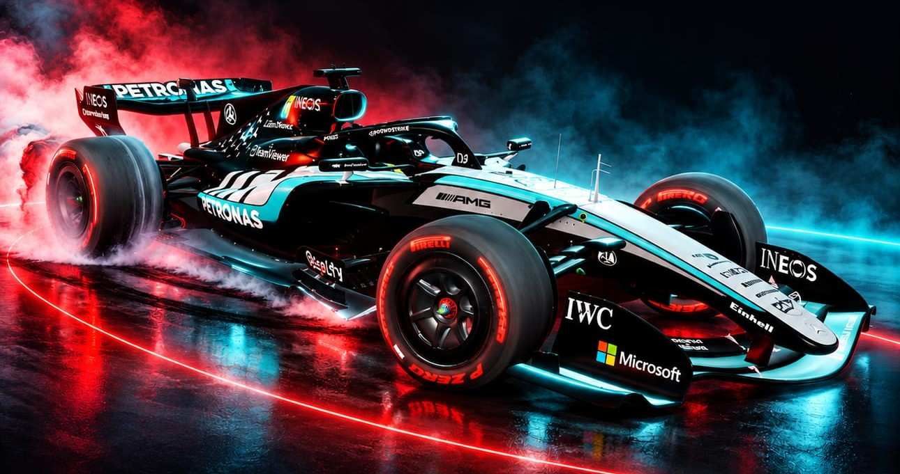

# 🏎️ F1 Drift

Fast open-world / race / drift racing game for Android – nitro boost, drift score, 14+ cars, day/night, rain.

## ⬇️ Download (Android)

**[Download F1-Drift.apk](https://github.com/anuj263vishwa-crypto/f1-drift-app/releases/latest/download/F1-Drift.apk)**

1. Open the link on your phone and download the file.
2. Tap it to install. Android may ask to allow *Install unknown apps* for your browser – allow it.
3. Open **F1 Drift**. Updates come inside the game (Menu → *Check for update*), no re-install needed.

Needs Android 6+ and a phone with ~4 GB RAM or more. If it feels slow: Menu → Graphics → **Low**.

## 💻 Download (Desktop)

| Platform | File |
|---|---|
| **Windows** installer | [F1-Drift-Setup.exe](https://github.com/anuj263vishwa-crypto/f1-drift-app/releases/latest/download/F1-Drift-Setup.exe) |
| **Windows** portable (no install) | [F1-Drift-Portable.exe](https://github.com/anuj263vishwa-crypto/f1-drift-app/releases/latest/download/F1-Drift-Portable.exe) |
| **Linux** | [F1-Drift.AppImage](https://github.com/anuj263vishwa-crypto/f1-drift-app/releases/latest/download/F1-Drift.AppImage) (`chmod +x` then run) |
| **macOS** Apple Silicon (M1/M2/M3) | [F1-Drift-mac-arm64.dmg](https://github.com/anuj263vishwa-crypto/f1-drift-app/releases/latest/download/F1-Drift-mac-arm64.dmg) |
| **macOS** Intel | [F1-Drift-mac-x64.dmg](https://github.com/anuj263vishwa-crypto/f1-drift-app/releases/latest/download/F1-Drift-mac-x64.dmg) |

The apps are not code-signed, so Windows SmartScreen may show *"Windows protected your PC"* → click **More info → Run anyway**. On macOS: right-click the app → **Open**.
Desktop tips: **F11** = fullscreen, keyboard + mouse controls (see below). The game tells you inside the menu when a new version is out.

## 🎮 Controls
Touch: steer ◀ ▶, **GAS**, **BRAKE**, **HAND** (handbrake), **GEAR ±**, **NITRO** (tap to toggle).
Keyboard: arrows / WASD, Space = handbrake, **N** = nitro, E/Q = gears, C = change car, F = driver view.

## 🙏 Credits
- 2026 Red Bull Racing RB22 – Dave Love (Sketchfab, CC BY 4.0)
- Mercedes-AMG GT3 Evo – vecarz (Sketchfab, CC BY 4.0)
- Koenigsegg Jesko, Ferrari FXX-K Evo, Mazda Furai, Apollo Intensa Emozione – kevin / sohyalebret (Sketchfab, CC BY 4.0)
- Built with three.js and Capacitor.
